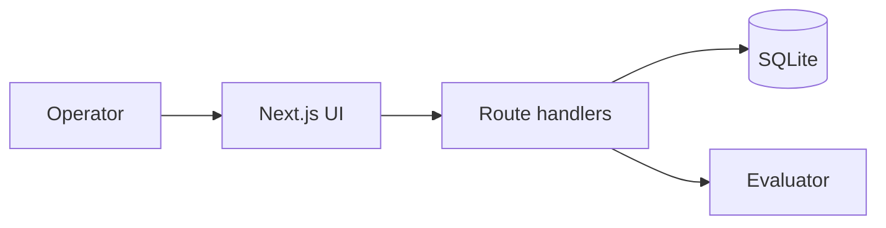

# ReleasePilot

A local feature-flag control plane. I create flags, assign a stable cohort, refuse a stale write, and store the change in an audit row.

**Status:** I built this as a portfolio system. One SQLite file and one admin key. It is not a hosted flag service.

## Problem

A boolean flag does not answer three questions a rollout actually has: will this subject stay in the cohort if the percentage goes up, does an emergency off switch beat the percentage, and what happens when two people save at once.

## Design



- **Cohort.** SHA-256 of salt, flag key, and subject maps into 10,000 buckets. A subject included at 25% stays included at 40%. The evaluator does not write a row per subject.
- **Kill switch.** `enabled=false` returns false even when the rollout is 100%.
- **Conflicts.** `PATCH` requires the current `version`. The update and the audit insert commit together. A stale version returns 409.
- **Secret.** `ADMIN_KEY` stays in the environment and is compared in constant time. The browser keeps the typed key in memory for the tab and sends it as `x-admin-key`.

## Run

Node.js 22 or newer (`node:sqlite`). The CI image uses Node 26.

```bash
cp .env.example .env.local
# ADMIN_KEY must be at least 24 characters
npm install
npm run dev
```

Open `http://localhost:3000`. `npm test` and `npm run build` verify the project. The database file is `data/releasepilot.db` and is gitignored.

`POST /api/flags` creates a disabled flag. `PATCH /api/flags/{key}` with `{"version":1,"enabled":true,"rollout":25}` changes it. `GET /api/flags/{key}` returns the flag and the last 50 audit entries. The flag panel can show those entries. `POST /api/evaluate` with `{"key":"...","subject":"account-42"}` returns the decision, bucket, and version.

## Tests

`npm test` covers stable decisions, rollout bounds, validation, the version conflict, route create/update/evaluate, the kill switch, and cohort monotonicity when the percentage increases. CI runs the tests and the production build.

## Limits

One shared admin key. The evaluate route uses that same key. No organizations, environments, or SDK tokens. SQLite is local to one process. A public deployment would need TLS, a real identity provider, rate limiting, backups, and a separate low-privilege evaluation credential. Subject ids are not stored.

## Decisions

- [ADR 001 Deterministic cohorts](docs/adr-001-deterministic-cohorts.md)
- [ADR 002 Optimistic audit](docs/adr-002-optimistic-audit.md)
